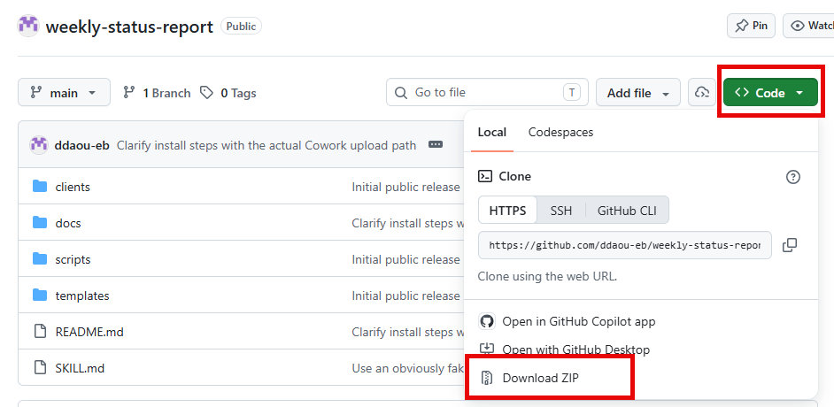
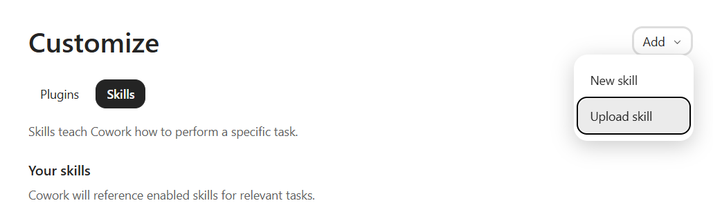

# Meeting File Organizer

A Microsoft Copilot Cowork skill that keeps your clients' SharePoint project folders complete. On a schedule, it files the transcripts and videos from Teams meetings you organized with each client into that client's folders, sorts each meeting into internal or external, and emails you a summary of what it filed. It never deletes anything.

## Install

1. Download this repo as a zip (Code → Download ZIP on GitHub), or clone it.

   

2. In Copilot Cowork, go to **Customize → Skills**, click the arrow on the **Add** button, and choose **Upload skill**.

   

3. Upload the zip from step 1.
4. Say "set up meeting file organizer for [client]". It will walk you through one-time setup (meeting keywords, the client's email domain, and SharePoint folder links), show you what it would file before copying anything, and save your own profile.

Your client profiles are saved in your own OneDrive at `Documents/Cowork/profiles/meeting-file-organizer/`, outside the skill. They are never part of the skill, so sharing or updating the skill never shares or overwrites your settings.

## What's in this repo

- `SKILL.md`: the skill's instructions
- `docs/`: the two screenshots above

## Updates

This repo is maintained by [Daniel Daou](mailto:ddaou@eidebailly.com). Pull the latest whenever there's a new version.
