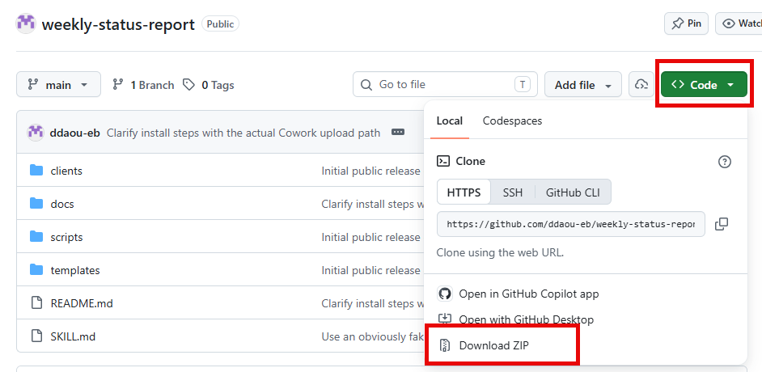
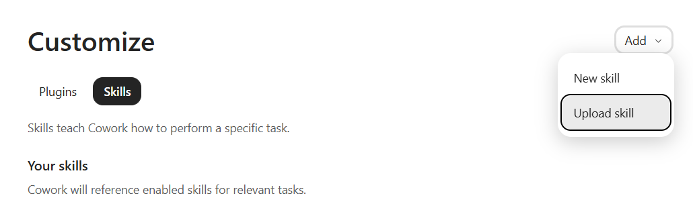

# client-recording-uploads

A Microsoft Copilot Cowork skill that files your clients' Teams meeting transcripts and recordings into each client's SharePoint folders on a schedule. It sorts each meeting into internal or external and emails you a summary of what it filed. It never deletes anything.

## Install

1. Download this repo as a zip (Code → Download ZIP on GitHub), or clone it.

   

2. In Copilot Cowork, go to **Customize → Skills**, click the arrow on the **Add** button, and choose **Upload skill**.

   

3. Upload the zip from step 1.
4. Say "set up recording uploads for [client]". It will walk you through one-time setup (meeting keywords, the client's email domain, and SharePoint folder links), show you what it would file before copying anything, and save your own profile under `clients/`.

Your client profiles never leave your own copy: the `clients/` folder ships empty and is gitignored, so nothing you configure gets shared back here.

## What's in this repo

- `SKILL.md`: the skill's instructions
- `clients/`: where your own client profiles get saved (empty here on purpose)

## Updates

This repo is maintained by [Daniel Daou](mailto:ddaou@eidebailly.com). Pull the latest whenever there's a new version.
